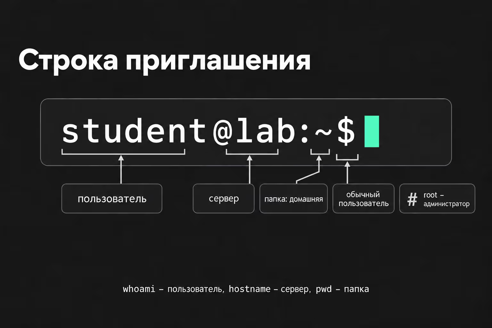
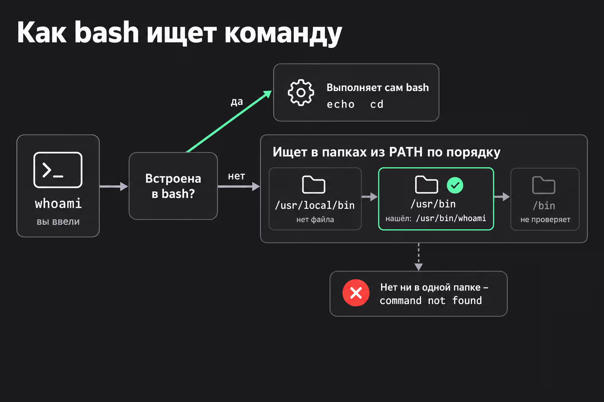
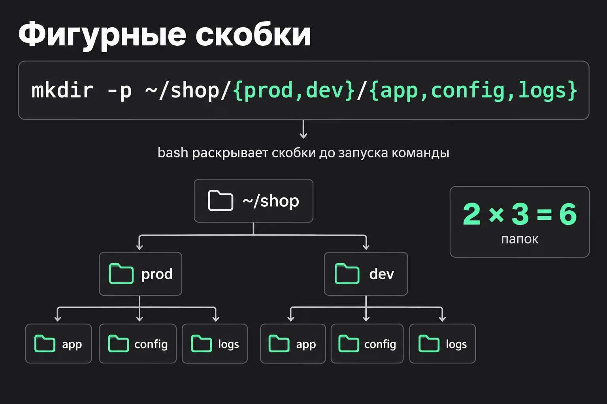

# Введение

Терминал - это текстовый интерфес для взаимодействия с сервером.
Как правило на серверах **НЕТ** графического интерфейса и все взаимодействие происходит через терминал.

Внутри терминала работает программа-оболочка. На серверах с Ubuntu – самой распространённой версией Linux для серверов – это **bash** (Bourne Again Shell, Борн - имя создателя первой shell, shell - оболочка/ракушка с ангийского).
Она читает то, что вы ввели, и после нажатия Enter выполняет.



## Как баш ищет введенные нами команды

> Команды которые мы вводим могут быть **встроенными в bash** или **быть отдельными программами**, то есть отдельными файлами в директории.



Если программа не встроена, то баш ищет название этой программы на диске.
Искать программу по всему диску было бы долго.
Поэтому bash **смотрит только в папки из списка, который хранится в переменной PATH.**

Стандартной директорией считается `/usr/bin`

> Также можно запустить программу указав полный путь. Т.к. папки с программой может не быть в PATH, и bash её не просмотрит, явный путь прямо покажет какой файл запустить.

## История введенных команд

Bash запоминает введенные вами команды, а когда вы закрываете терминал, сохраняет в файл ~/.bash_history в домашней папке. Посмотреть список с нумирацией можно командой: `history`

`!5` – выполнить команду под номером 5;
`!!` – повторить последнюю команду. Частый случай: команда не сработала, потому что не хватило прав, и вы выполняете `sudo !!`. Прежде чем нажать Enter, вспомните, что было последним: команда повторится с правами root;
`!$` – подставить **последний аргумент** **предыдущей** команды. Аргументы – это то, что пишут после имени команды через пробел. После ls /var/log можно написать cd !$, и вы окажетесь в /var/log.

> `Ctrl+R` - позволяет производить поиск по истории команд. Enter выполняет найденное, стрелка вправо оставляет команду в строке, чтобы её поправить.

Сколько команд помнить, задаётся в файле `~/.bashrc` – это настройки bash, которые он читает при каждом запуске.
В Ubuntu там по умолчанию стоит 1000 команд в памяти и 2000 в файле. Для работы с серверами этого мало, поэтому размер обычно увеличивают

```bash
HISTSIZE=10000          # сколько команд держать в памяти
HISTFILESIZE=20000      # сколько хранить в ~/.bash_history
HISTCONTROL=ignoredups  # не записывать одинаковые команды подряд
```

## Синтаксис в командах

### {}

 Если нам нужно применить одну и ту же команду к нескольким элементам, мы можем перечислить эти элемены **в фигурных скобках, через запятую, без пробелов**.  
Прежде чем запустить команду, bash раскрывает фигурные скобки в список



- Помимо перечесления, можно использовать диапазон, например

```bash
touch report-{1..5}.txt # создаст или обновит время модификации у  файлов report-1.txt, report-2.txt, etc
mkdir day-{a..c} - # создаст папки day-a, day-b, etc
```

### $

- `$` это знак подстановки результата одной команды в **синтаксис** другой.

Например `tar czf "/backup/dostavka_$(date +%Y-%m-%d_%H-%M).tar.gz"`

### \

`\` - обратный слеш в конце строки переносит команду на следующую строку: это всё ещё одна команда, просто так её легче читать.

```bash
tar czf "/backup/dostavka_$(date +%Y-%m-%d_%H-%M).tar.gz" \
    --exclude='*.log' \
    --exclude='cache' \
    -C /opt dostavka
```
