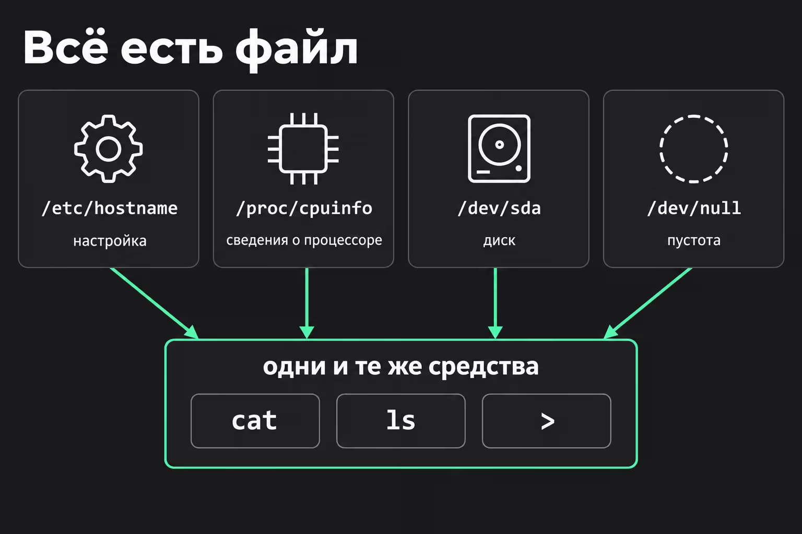
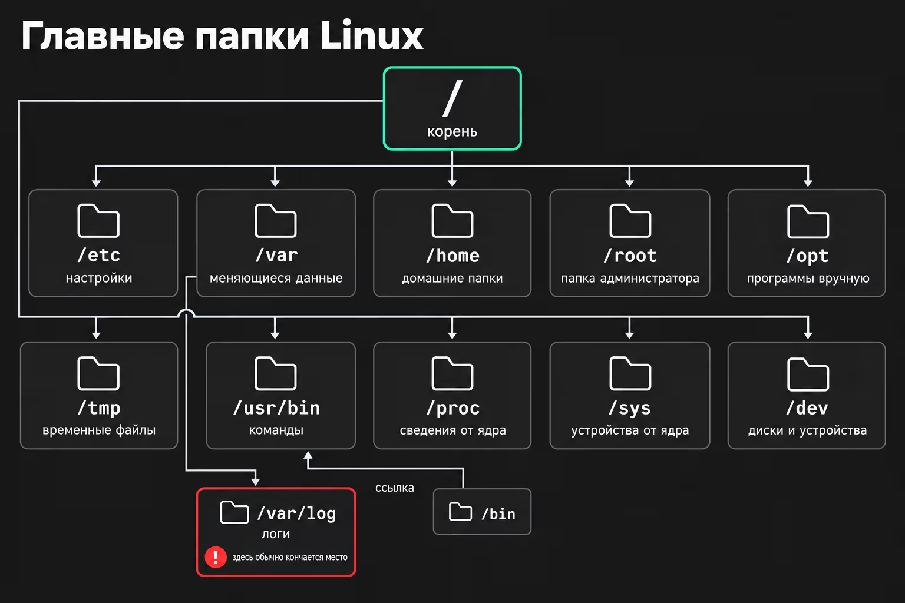
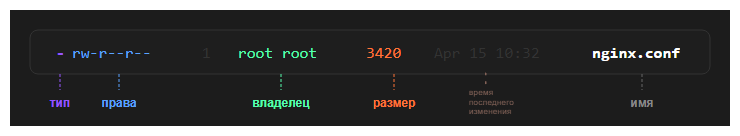
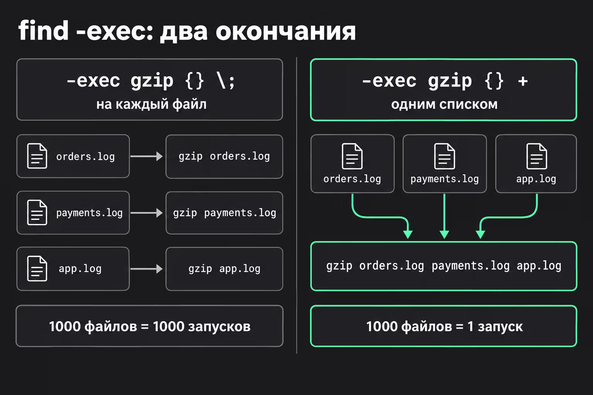

# Файловая система

Если в виндовс файловая система строиться на дисках (`C:`, `D:`, etc), то в UNIX подобных системах все файлы и папки собраны в одно дерево.

> Стоит отметить что в UNIX системы придерживаются концепции,что **любая сущность есть файл**: настройки, сведения о процессоре, диски и даже «пустота»



Практически все UNIX подобные системы, придерживаются стандарта FHS (Filesystem Hierarchy Standard), который определяет назначение папок.



- `/` - корень, начало всех начал. Права писать в корень есть только у суперюзера (он же root)
- `/etc` - файлы с настройками систем и программ. (название исторически сложилось, т.к. изначально сюда скидывали все что не подходит под другие папки)
- `/var` - тут лежат данные которые постоянно изменяеются (variable - переменные): логи, базы данных и т.п.
- `/var/logs` - логи. **Чаще всего иммено здесь кончается место**
- `/home` - директория для папок пользователей, например `/home/maslovso`
- `/root` - домашняя папка суперпользователя, сознательно отделена от папки `/home`
- `/opt` - стороннее программное обеспечение и пакеты, не входящие в стандартную поставку системы
- `/tmp` - папка для временного хранения. **Отчищается при перезапуске системы** (но зависит от системы)
- `/usr/bin` - хранят пользовательские команды (`ls`, `whoami`, etc). Раньше было разделение на `/bin`(команды без которых системв бы не запустилась) и `/usr/bin`(все остальное), но на современных системах разницы нет. Сейчас используется UsrMerge (объединение папок)  папка `/bin`, отсылает к папке `/usr/bin`
- `/dev` - от слова **device**, специальные файлы, которые выступают в роли интерфейса между аппаратным обеспечением и программным обеспечением.
  - `/dev/null`, псевдоустройство, которое принимает любой ввод и ничего не хранит (можно отправлять файлы которые не нужно хранить)
  - `/dev/zero` - выдаёт нулевые байты без конца
  - `/dev/urandom` - выдаёт случайные байты без конца
- `/proc`, `/sys` — это виртуальная файловая система, предоставляющая интерфейс к внутренним структурам ядра

## Информация о файлах

Информацию о файлах можно получит с помощью команды `ls -l`, которая выведет список файлов в рабочей директории в виде списка, у каждого файла будет собственная строка вида


Флаги, которые могут пригодиться для команды `ls`:

`-a` – показать и скрытые файлы: в Linux скрыты те, чьё имя начинается с точки, например .bashrc;  
`-h` – размеры в понятном виде: 4.0K, 1.2M, 3.8G;  
`-t` – сначала самые свежие;  
`-S` – сначала самые большие;  
`-r` – обратный порядок

---
Также можно отобразить иерархию файлов и папок с помощью команды `tree`

Флаги:
`-L2` – не глубже двух уровней: на больших папках без этого ответ займёт тысячи строк;  
`-d` – только папки;  
`-a` – вместе со скрытыми файлами  

---
Для поиска файлов используется команда `find`, которая имеет очень мощный функионал для поиска, например

```bash
find /etc -name "*.conf"      # имя по маске: всё, что кончается на .conf
find /var/log -type f         # только файлы
find /var/log -type d         # только папки
find /var/log -size +100M     # больше 100 мегабайт
find /var/log -mtime -1       # дата модификации меньше суток
find /var/log -mtime +30      # дата модификации больше 30 суток
find /home -user student      # принадлежат пользователю student
```

> Если условий несколько, `find` ищет файлы, которые подходят под все сразу.

Также у команды есть флаг `-exec` который позволяет выполнить какую то команду со **всеми найденными файлами**

Есть два формата:

- `find <find condition> -exec <command> {} \;`
- `find <find condition> -exec <command> {} +`
Где вместо `{}` команда подставляет путь до найденног файла, а символы `\;` и `+` будут определять как запускать пользовательскую команду: для каждого файла и собирает имена в одну команду.

Например:


## Информация о
