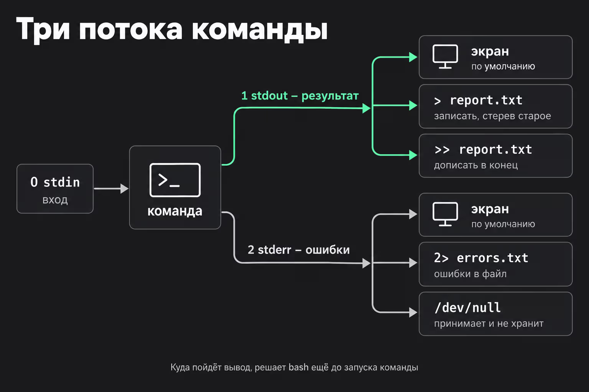
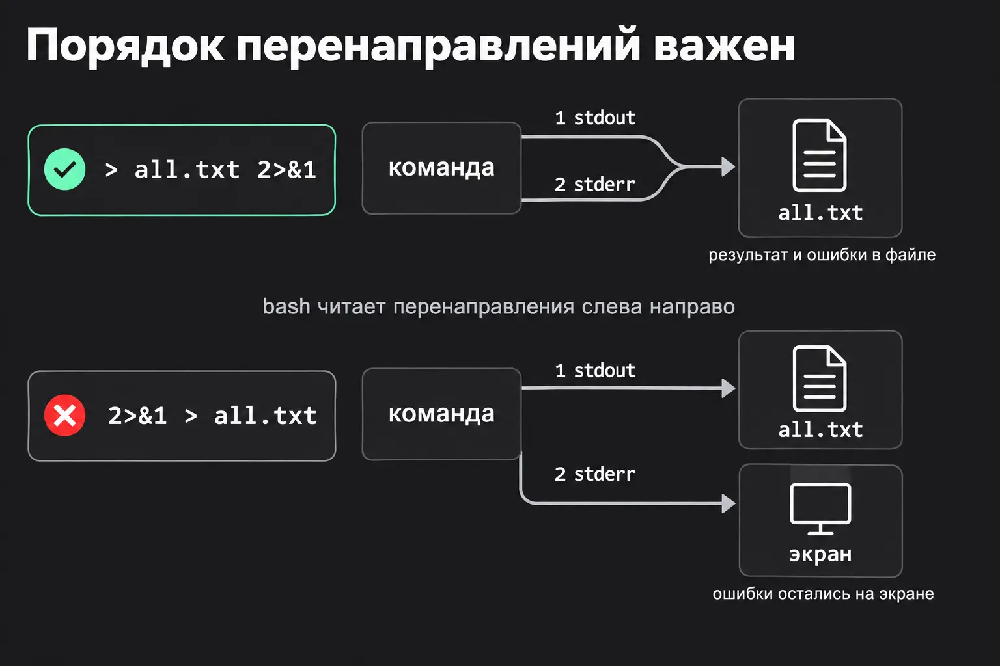
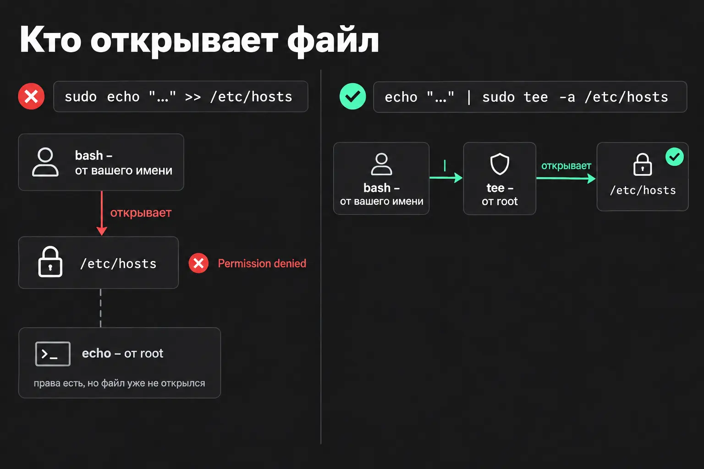
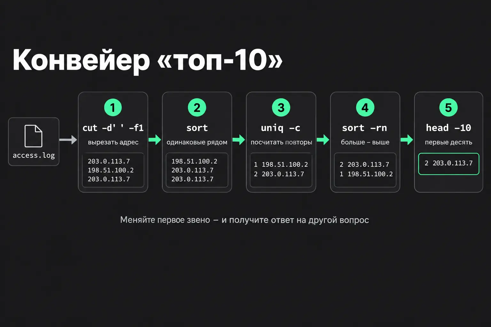

# Потоки

В Linux все процессы работают в рамках трёх потоков:

- **stdin (0)** - стандартный ввод (то что команда принимает)
- **stdout (1)** - стандартный вывод (то что команда отдает)
- **stderr (2)** - стандартная ошибка

- `>` - одинарный символ **заменяет** содержимое целевого объекта на перенапрвленный **вывод**
- `>>` - двой символ перенаправление **дописывает** данные с **вывода** в целевой объект  
- `|` - **перенаправление** **вывода** одной программы на **поток ввода** другой
- `1>` - перенаправление потока стандартного вывода
- `2>` - перенаправление потока ошибок
- `&>` - перенапрвление **и потока вывода и потока ошибок**
- `>&{}` - перенаправление из одного потока в другой. например `2>&1` отправь поток 2 туда же, куда сейчас идёт поток 1.
- `&&` - Создание "списка" последовательно выполняемых команд. Команды, разделённые двойным амперсандом, выполняются последовательно, каждая следующая — только если предыдущая не завершилась ошибкой (вернула код выхода 0).
- `<` - символ перенаправление перенаправления **stdout**. Например `wc -l < /var/log/dostavka/app.log` или `diff <(ls /opt/dostavka/releases/v1) <(ls /opt/dostavka/releases/v2)`

Также вашен порядок записы вывода:

## Конвеер команд с `|`

`|` - перенаправляет stout одной команды в stdin другой

## Sudo при потоках

При попытке записи в файл, который может менять только `root` команда типа `sudo echo "10.0.0.5 db-orders" >> /etc/hosts` не сработает, потому что:  
**Ещё до запуска команды** bash выполнит перенаправление `>>`  **от имени пользователя**, а не от имени `root`.

Правильно вот так:
`echo "10.0.0.5 db-orders" | sudo tee -a /etc/hosts`

## xargs

Некоторые команды не воспринимают `stdin`, они работают с аргументами. (например `rm`, `mv`, `cp`, `mkdir`, etc).

`xargs` - превращает свой `stdin` в аргументы для другой команды. Например `find /var/log/dostavka -name "*.log" -mtime +30 | xargs rm` (`find` выводит пути по одному на строку, а `xargs` собирает их и запускает `rm file1 file2 file3 …`.)

Полезные флаги:

- `-I <marker>` - подставить каждую строку в нужное место команды. Например `xargs -I {} cp {} /backup/`
- `-n <n>` - по n строк за запуск команды.
- `-P <n>` - до n запусков одновременно
- `-0` - имена разделены нулевым байтом, а не переводом строки

Имена с пробелами ломают xargs. old orders.log превратится в два аргумента.
Поэтому **надёжная связка** это `find -print0 | xargs -0`. Find с флагом `print0` разделяет имена нулевым байтом, а `xargs` c флагом `-0` понимает такой разделитель.
Например - `find /var/log/dostavka -name "*.log" -print0 | xargs -0 gzip`

## Топ-n шаблон

