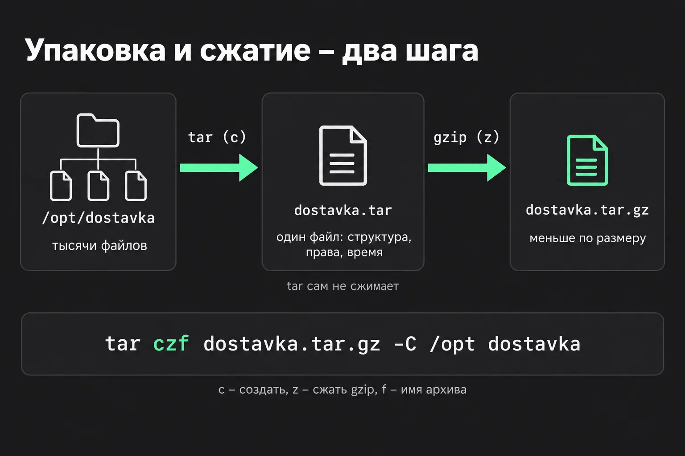
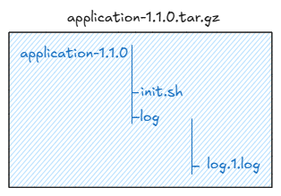

# Архивы_сжатие_передача_файлов



Команда `tag` имеет несколько разновидностей, чаще всего используемые:

```bash
tar czf dostavka.tar.gz /opt/dostavka   # создать сжатый архив
tar tzf dostavka.tar.gz                 # показать, что внутри
tar xzf dostavka.tar.gz                 # распаковать в текущую папку
```

Буквы после `tar` – это флаги, записанные слитно. Утилита `tar` имеет очень старую архитектуру, поэтому исторически придерживается стиля написания флагов без тире.

**Первой идёт одна буква действия:**

- `c` (create) – создать архив;
- `t` (list) – показать список файлов в архиве, ничего не распаковывая;
- `x` (extract) – распаковать

Дальше – уточнения:

- `z`, `j`, `J` – каким сжатием пользоваться: `gzip`, `bzip2` или `xz`.
- `f` (file) – следом идёт имя файла архива. **Без него tar читает архив из stdin и пишет в stdout**. Тут должно содержать имя архива после его создания.
- `v` (verbose) – печатать имя каждого файла по ходу работы;

> Внутри архива все файлы и папки лежат в директории с названием архива, то есть в пути сначала имеют название архива.
> Например внутри `application-1.1.0.tar.gz` сначала будетвсе пути будуь начинаться с **application-1.1.0**:  
> `/application-1.1.0/`,  
> `/application-1.1.0/init.sh`,  
> `/application-1.1.0/log`,  
> etc...  
> 

При распаковке такого архива сначала будет создана папка `application-1.1.0`, а уже внутрь нее будет распакованы все остальные файлы.

- `--strip-components=<n>` - флаг позволяющий срезать n-ую часть пути. Для того чтобы распаковать файлы без корневой для архива директории. Например `tar xzf dostavka-2.4.0.tar.gz --strip-components=1 -C /opt/dostavka`

- `-C <path>` - или (`--directory`) в tar означает «сменить рабочую директорию **на время выполнения команды**» — по сути, аналог команды cd прямо внутри вызова tar.

> Для создания архива с датой в названии можно использовать резульат работы команды `date`. `tar czf "/backup/dostavka_$(date +%Y-%m-%d_%H-%M).tar.gz /opt/dostavka"

- `--exclude` - Флаг исключает из архивирования файлы подходящие под маску. Например

  ```bash
  tar czf "/backup/dostavka_$(date +%Y-%m-%d_%H-%M).tar.gz" \
    --exclude='*.log' \
    --exclude='cache' \
    -C /opt dostavka
  ```

- `--exclude-from=<path>` - также можно исползовать файл с исключениями в котором будут перечисленны маски или имена на каждой новой строчке
